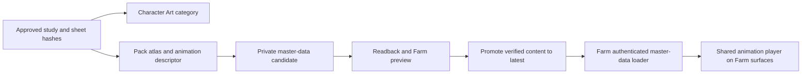

# UA15 — Uma Farm walking sprites

**Status · Implementation packet, 2026-11-23.** Farm needs three sprite outfits per Uma for every map and in-world interaction. Tier 1 is the first runtime release. The other 40 launch Umas use the same contract as their approved art arrives.

## What is ready

| Layer | Verified state | Next step |
|---|---|---|
| Local Art Authoring | 50 album entries prepared. Ten Tier 1 Umas have active owner-approved studies with 30 looks and 150 matching PNG hashes. The studies record 120 standing frames and 840 walking frames. | Use the current active study and its recorded approval per identity. |
| Hosted Character Art | PR #116 added the Character Sprites category and deployed successfully. The private Farm Life index contained zero sprite sheets when checked. | Publish the approved Tier 1 selection using the existing category publisher. |
| Master data | The live v1 channel was `ad2ac3608ff1` at intake. Its eight existing `outfit-sprites` sets are the older traveler and townsfolk packs. | Add a separate optional family for character animation variants, composed over the live release. |
| Uma Farm | The Field and Pond scene draws procedural work figures and its `LookAssets.sprite` callback returns null. F113's Town uses painted maps and tappable doors. Night scenes already have their own portraits, splash art and replays. | Load the shared runtime family through the existing authenticated content client and use it for in-world actors. |

One Tier 1 exception needs a small compatibility rule. Kitasan Black's approved Farm Work front and back clips supply six 110 ms frames each and omit the redundant total-duration field. The packer can derive 660 ms from those exact frame times. Keep the approved PNG bytes and frame order. If any stated total disagrees with its frames, report the study and fail that selection.

## Exactly three sprite outfits

| Runtime variant | Source prefix | Outfit selection in Farm |
|---|---|---|
| `spring` | `spring` | General outfit in every season. Town, public visits, free time, daytime home, dates, festivals, weddings and public evening events. |
| `pajamas` | `pajama-07` for the approved Tier 1 batch | House or Inn bedtime, overnight visits and wake-up movement. A solo or duo visit uses one resolved sprite per participant. |
| `farm-work` | `farm-work` | On a scheduled or recorded farm assignment and on the walk between farm jobs. Includes field/orchard, ranch, fishing, gathering, stations, and shipping where the game renders those jobs. |

The scene selects the outfit from the activity. A house during the day still uses Spring. Town at dusk still uses Spring. A spouse on a town shift wears Spring. A worker doing chores at dusk wears Farm Work. A private night visit uses Pajamas. The timeline can switch outfits at scene boundaries such as coming off shift or going to bed.

The approved `pajama-07` design supplies the small in-world sleepwear sprite for Tier 1. Its runtime key stays `pajamas` for future Umas even if their approved sleepwear source has a different name. This representation is available wherever the character can already appear at bedtime. Night-wardrobe progression, illustrations, anniversary and birthday portraits, expressions, and Library unlocks use their existing content rules.

## Bundle format

One sprite set is **one identity × one variant × one approved revision**. For one variant, use the standing strip and four walked strips referenced in `study.json`. Read source rectangles and frame order from the metadata. Source sheets come from `manifest.json`, with `active-study.json` choosing the version. Keep masters, prompts, PNGs, proof and GIF previews in the private authoring workspace.

| Direction | Stand | Walk |
|---|---:|---:|
| Front | 1 | 6 × 110 ms |
| Back | 1 | 6 × 110 ms |
| Left | 1 | 8 at the recorded 80/90 ms cadence |
| Right | 1 | 8 at the recorded 80/90 ms cadence |
| **Per variant** | **4** | **28, each directional loop lasts 660 ms** |

Use the native **64 × 88** cell and its **(32, 84)** foot anchor. Match the approved standing pose for each drawn direction. The renderer uses nearest sampling, preserves alpha and draws shadows separately. Reuse the recorded frame times. A walk keeps its cycle while moving, stops on the correct standing view, and uses the other independently drawn facing when turning. Map labels, emotes, weather colour, glow and job feedback can be reusable presentation layers.

Pack 32 native cells into one padded atlas page per variant. Start with a 512 × 512 lossless atlas and measure it during the pilot. Two pixels of padding on every side leave room for all cells. Preserve original frame offsets. Use lossless WebP if the decoded pixels match the approved crops, and PNG if the encoder cannot preserve them. Round-trip every crop against `sha256Rgba` when provided. Compare transparent pixels consistently at both ends of any encode. Derive any missing summary fields from verified frames and record the derivation. Trimming is optional after measuring. Leave per-variant pages separate so a town visit needs only Spring.

The intake trial decoded all 960 source crops and matched every recorded RGBA hash. All 30 proposed 512 × 512 pages round-tripped through lossless WebP. They totalled 3,485,814 bytes, with the largest page at 142,304 bytes. This measured the page encoding in memory. Publishing still needs hashed descriptors, the candidate composer and end-to-end readback.

The candidate must contain 30 independently loadable sets for Tier 1. The full roster is 150 sets. Record source and packed hashes, page bytes, dimensions, decoded size, and the exact active version and runtime identity for each. Rerunning the selection against the same source should yield identical runtime assets.

### Identity and shared code

Use the existing neutral character/outfit identity from dialogue portraits and illustrations. For an original character, use her real master `characterId`. For a ranked sister with her own art, carry her real `characterId` and numeric `outfitId`, resolving the Farm roster key through its cast adapter. Keep the author's local name and slug for locating files and displaying reports. Validate that the outfit belongs to the character in base master data. Key sets by full identity and variant. An absent sister or missing outfit is an ordinary missing asset result.

Add an optional `characterSprites` art-index map and a corresponding validated reader in `uma-data`. A map entry groups its supported variant keys, each pointing at a hashed atlas descriptor. The shared schema accepts neutral variant keys. Farm owns the three-variant rule and how a scene chooses one. Use an additive `uma-data` minor with synthetic fixtures. The old `sprites` map and numeric `spriteSet(outfitId)` stay compatible for existing readers.

Reuse the shared stage's `AtlasPlayer`, facing rules and frame/page geometry. The stage adapter needs `turnaround` and `walk-front/back/left/right`, with the recorded feet and still view tags. Generalize the renderer's sprite source to the fields it consumes so a 64 × 88 set can use the existing animation player without inventing legacy battle fields. The Farm renderer owns screen/world scale, uses its actual front-facing camera, and keeps the foot stable across wardrobe changes. Existing traveler and townsfolk actors retain their size, frame timing and battle features under the shared package tests.

## Publish and deploy

1. **Review and gallery publication.** Use the Art Authoring repository's existing `pnpm run publish farm-life --category character-sprites --only <approved-keys> --dry-run`. The real invocation follows the established gallery publishing instruction. Confirm the 150 approved entries in the live Character Art index and their matching hashes, and compare unrelated entries against the previous index. This channel serves album review sheets.
2. **Gameplay pack.** Implement a selected-character sprite packer in Platform. Read private approval records and normalized source paths directly, with stable identity checks and a dry-run plan. Upload only validated atlas pages and compact JSON descriptors to a candidate on `uma-platform-master-data`. Add a dedicated character-sprite-only option to the release composer using the existing selected-family pattern. The current legacy `sprites:pack` and `--sprites-only` path targets `outfit-sprites`.
3. **Candidate readback.** Pin the version of `latest` the candidate was composed over. Extend `release:check --channel candidate --against <base>` to read through the new client and decode every selected atlas. Verify descriptor identities, all variant keys, source/decoded hashes, bounds, alpha, timing and the exact family diff. Unselected characters, old outfit sprites, portraits, illustrations and master sets carry over by hash. A failed verify or a concurrent advance of `latest` stops promotion. Recompose over the new parent and recheck if another release wins.
4. **First Farm app deployment.** Release the reader and any stage adapter package changes, then pin those exact versions in Farm. Preview with the verified candidate and a disposable save. Merge and deploy through the normal Farm PR, CI and Firebase workflow after the preview passes. A deployed reader can safely boot on an empty or partial sprite index.
5. **Promote and verify production.** Move `latest` to the exact candidate read back while checking the expected parent generation. Farm uses its existing owner-only `/api/master` endpoint and loads content from the channel on the next normal boot. Verify the channel, manifest and selected atlas bytes through that path. Check the signed-in game and the current web deployment. Picture-only revisions and new approved waves then publish through the content flow without an app build when the three-variant contract is unchanged.
6. **Correct a release.** Keep approved revisions and immutable files available. If the promotion fails immediately and the current channel still points to that exact release, use the guarded rollback to the checked parent. If newer unrelated content has landed, compose a corrective character-sprite release over the new parent. Verify the affected set and perform a signed-in boot again.

Gameplay sprite binaries and private approval files stay under ignored authoring and release storage. Git carries the reader, packer, tests and documentation. Game-side code consumes the private master release through its current read-only proxy. The web app downloads each atlas lazily from the manifest alongside its normal cache policy.

## Farm integration

| Order | Surface | In-game behavior |
|---|---|---|
| 1 | Field and Pond HD-2D | Replace visible work figures with Farm Work actors. Tie paths between known work positions to actual crew assignment and the current morning's execution. Use ledger/report evidence where available. If the existing projection cannot distinguish two locations or see auto assignments, project that evidence before placing actors. The rendering layer never spends actions, produces stock or changes schedules. |
| 2 | Town districts and public outings | Place Spring actors at a few authored paths and waiting points on the district paintings. Use normalized feet positions that follow the painted image as it resizes, with draw order from feet. Read town presence, shift/outing and expedition absence. Keep F113's tappable roofs and doorway targets as the navigation controls. Public dates and festival walk-up views use the same actors. |
| 3 | Harbour Inn, farm homes and visits | Use Spring in the daytime lobby and home commons. Use Pajamas for walking to a room at bedtime and for any visible movement before or after a night visit. Read actual Inn or farm residence and current availability. Housed spouses still appear at work in town on their scheduled shifts. In duo scenes, resolve both actors independently and keep the existing portrait and splash sequence. |
| 4 | Remaining visualized work and events | Apply the same outfit-selection function to orchards, ranch, workshops, shipping and other farm views as a view gains an actor stage. Scripted walk-ons, approaches, stops and exits can use drawn facings with the same three assets. Use the existing action, gift, date, festival and replay entry points. |

On covers, profile lists, conversation illustrations and Library playback, use the art already authored for those views. In-world staging uses the actor only where the scene displays a moving figure. A walk represents travel or approach. Work motions such as watering or hammering can reuse standing views with props or effects until there is an authored action. The farm rules keep credit for the actual job.

## Performance and fallback

- Begin with Field and Pond's existing six visible positions. Reuse the shared nearest-actor cap as the starting point for denser scenes. Show the full crew in Work and the full town cast in the district's People panel. A 512 × 512 RGBA atlas occupies about 1 MiB decoded. Eight live pages would be about 8 MiB of raw texture storage before driver overhead and other scene textures. Measure download, decode, frame pacing and memory on the phone before raising the cap.
- Load only each visible actor's selected variant. Deduplicate in-flight fetches by release, identity and variant and share decoded atlas resources by file hash. Limit fetch/decode concurrency. Keep the current manifest consistent across a scene. Release textures and bitmaps when old scenes or residents leave view. Pause hidden animation and avoid rendering while the Home Screen app is backgrounded.
- Keep the existing standee or procedural figure if a set or texture is unavailable. Try the same identity's Spring set as a secondary option where it fits the scene. If only a direction is unavailable in an old candidate, hold the matching still where it exists. A missing or corrupt atlas falls back locally. Map taps, menus, saves, work and story stay playable on slow or offline loads.

## Acceptance and rollout

| Gate | Evidence |
|---|---|
| Art to runtime | Every approved Tier 1 identity has exactly three sets. All 960 decoded frames match source crops. All 120 walks loop with the recorded timing. No cropped ears, feet or asymmetric ornaments. Test a base and sister identity with synthetic data and run the existing traveler/townsfolk test suite. |
| Farm rules | Test solo and 10-, 20- and 50-Uma saves at 844 × 390 and 667 × 375, using a phone for frame pacing. Compare rendered crew with actual shift, activity, work result, day off and expedition status. Verify one room assignment moves the same Uma from the Inn lineup to the farm and her shifts continue. |
| Three outfit paths | Follow the same Uma through a public visit, real farm work and an overnight visit. Test all four facings, a duo visit, date/festival entry, and replay. Check an unauthored roster member, absent variant, failed decode, slow/offline cache, background/resume and repeated scene transitions. |
| Live | CI passes and the production app build matches. Gallery index shows all named sheets. The signed-in game reads the promoted version, paints approved Tier 1 actors at their real locations, and falls back for the remaining roster. Correct one scoped pilot revision without disturbing the other assets. |

Start with one Tier 1 identity through all three environments in a candidate, then exercise all ten before promotion. Tiers 2–5 fill the same registry in approved batches. Record ready, gallery-published, candidate-verified and live-in-Farm coverage separately so a gallery badge and a game release each mean something specific.
